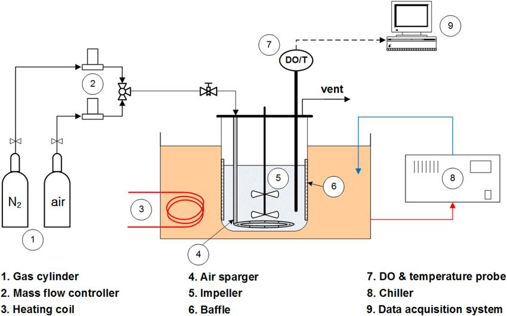
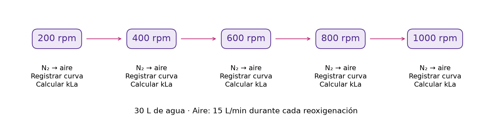

**Taller:** Transferencia de oxígeno en biorreactores

**Duración:** 30–45 min por equipo, incluidos registro y cálculos.

**Equipo:** reactor Sartorius de 50 L con 30 L de agua. Registrar modelo e identificación disponibles.

# 1. Objetivo

Determinar el coeficiente volumétrico de transferencia de oxígeno, kLa, mediante reoxigenación de agua a distintas velocidades de agitación. Cada equipo obtendrá una curva por velocidad, calculará el kLa correspondiente y construirá un barrido de kLa frente a rpm, con el volumen y la aireación constantes.

# 2. Fundamento teórico

## 2.1. ¿Qué es kLa?

El coeficiente volumétrico de transferencia de oxígeno, kLa, es uno de los parámetros más importantes para caracterizar la transferencia de oxígeno desde la fase gaseosa hacia el medio líquido de un biorreactor.

El oxígeno debe transferirse desde las burbujas de aire al líquido para estar disponible a las células. Este proceso es particularmente importante en cultivos de células animales, microorganismos y otros sistemas biológicos aerobios.

La velocidad de transferencia de oxígeno se expresa mediante:

$$\mathrm{OTR}=k_La\,(C^*-C_L)$$

Donde:

- **OTR:** velocidad volumétrica de transferencia de oxígeno, por ejemplo, mg O₂·L⁻¹·h⁻¹.
- **kLa:** coeficiente volumétrico de transferencia, h⁻¹.
- **C∗:** concentración de saturación o concentración de oxígeno disuelto en equilibrio con la fase gaseosa, mg O₂/L.
- **C_L:** concentración instantánea de oxígeno disuelto en el líquido, mg O₂/L.
- **C∗ − C_L:** fuerza impulsora para la transferencia de oxígeno.

El coeficiente kLa integra dos contribuciones:

$$k_La=k_L\times a$$

Aquí, $k_L$ representa el coeficiente de transferencia de masa en la película líquida y $a$ es el área interfacial gas–líquido por unidad de volumen de líquido.

Por tanto, kLa depende tanto de las condiciones hidrodinámicas prevalecientes en el biorreactor como de las propiedades físicas del sistema. No es una constante universal del biorreactor.

## 2.2. ¿Por qué es importante?

Un valor elevado de kLa generalmente permite transferir más oxígeno al medio cuando existe una diferencia entre la concentración de saturación y la concentración real. Sin embargo, un kLa alto no garantiza por sí solo que las células reciban suficiente oxígeno: también importan la demanda celular, la mezcla, los gradientes locales y la presión parcial del oxígeno.

En un cultivo celular, la velocidad de transferencia debe compararse con la velocidad de consumo de oxígeno, OUR. En estado estacionario:

$$\mathrm{OTR}=\mathrm{OUR}$$

Esta igualdad corresponde al estado estacionario en el balance de oxígeno disuelto, cuando no hay acumulación neta de oxígeno en el líquido, es decir, cuando $C_L$ es constante.

# 3. Métodos experimentales para determinar kLa

## Método 1. Dinámico de reoxigenación

Primero se desoxigena el medio, después se introduce aire y se registra el incremento del oxígeno disuelto con el tiempo. La medición requiere ausencia de consumo biológico y químico apreciable de oxígeno. Esto no equivale por sí solo a exigir esterilidad: en el taller se utiliza agua sin células añadidas y se supone despreciable el consumo durante el ensayo. Se obtiene kLa mediante una regresión lineal de la respuesta transformada.

## Método 2. Dinámico en un cultivo activo

Se modifica temporalmente la aireación o se interrumpe el suministro de oxígeno y se analiza la respuesta del oxígeno disuelto. Se necesita considerar el consumo celular de oxígeno, por lo que el cálculo es más complejo.

## Método 3. Balance de oxígeno en fase gaseosa

Se determina el oxígeno que entra y sale del biorreactor y se calcula la transferencia al líquido. Requiere analizar el gas de salida y corregir los balances por humedad, caudal y composición. El caudal de entrada puede determinarse con controladores de flujo másico y una composición de alimentación conocida; la concentración de oxígeno de salida puede medirse con sensores paramagnéticos en línea. Para cerrar el balance debe conocerse o estimarse también el caudal de salida.

En esta práctica se utiliza el método dinámico de reoxigenación, con volumen y aireación constantes y distintas velocidades de agitación.

# 4. Método dinámico de reoxigenación: ecuaciones y derivación

## 4.1. Balance de oxígeno disuelto

Para un líquido sin células, sin consumo biológico ni químico apreciable de oxígeno y bajo condiciones aproximadamente constantes, el balance es:

$$\frac{dC_L}{dt}=k_La\,(C^*-C_L)$$

Si $C^*$ y kLa permanecen constantes durante la medición, la integración entre el tiempo inicial $t=0$, con concentración $C_0$, y un tiempo $t$, con concentración $C_t$, da:

$$\int_{C_0}^{C_t}\frac{dC_L}{C^*-C_L}=\int_0^t k_La\,dt$$

$$\ln\left(\frac{C^*-C_0}{C^*-C_t}\right)=k_La\,t$$

Esta ecuación constituye la base del método. $C_0$ es la concentración inicial y $C_t=C_L(t)$ es la concentración en el tiempo $t$. El tiempo se cuenta desde el inicio de la reoxigenación. Deben mantenerse constantes la composición del gas de entrada, la presión, la temperatura, el caudal y la agitación durante cada curva.

La ecuación diferencial es de primer orden. Su solución también puede escribirse como:

$$C_t=C^*-(C^*-C_0)e^{-k_La t}$$

La constante de tiempo del modelo es $\tau=1/k_La$, usando unidades de tiempo compatibles. En una τ se recorre el $1-e^{-1}\approx63.2\,\%$ del cambio. Aquí τ describe la transferencia observada en el reactor; no es la constante de tiempo de la sonda aislada.

## 4.2. Forma lineal para el cálculo

Definimos la variable transformada:

$$Y(t)=\ln\left(\frac{C^*-C_0}{C^*-C_t}\right)$$

Al graficar Y contra el tiempo t, se obtiene una recta cuya pendiente es kLa:

$$k_La=\text{pendiente}$$

Si el tiempo está expresado en minutos, el resultado será min⁻¹. Para convertirlo a h⁻¹:

$$k_La\,[\mathrm{h}^{-1}]=60\,k_La\,[\mathrm{min}^{-1}]$$

Si se utilizan segundos, se multiplica la pendiente por 3600. La plantilla de cálculo del taller utiliza segundos.

### Oxígeno disuelto en porcentaje de saturación

Si la lectura es proporcional a la concentración y el 100 % representa la saturación de equilibrio, puede utilizarse directamente:

$$Y(t)=\ln\left(\frac{100-y_0}{100-y(t)}\right)=k_La\,t$$

Aquí $y_0$ y $y(t)$ son las lecturas inicial e instantánea, ambas en porcentaje de saturación. Esta expresión requiere que el equilibrio corresponda efectivamente al 100 % de la escala utilizada. Si la sonda usa otra referencia o cambian presión, temperatura o composición gaseosa, debe emplearse el valor de equilibrio apropiado:

$$Y(t)=\ln\left(\frac{y_\infty-y_0}{y_\infty-y(t)}\right)$$

$y_\infty$ es la meseta final con aire. En el taller se utiliza la meseta observada en las condiciones de cada ensayo, sin sustituirla automáticamente por 100 %.

Se ajusta una recta $Y=a+bt$; su pendiente $b$ estima kLa. Se permite una ordenada al origen para revisar posibles desplazamientos temporales y desviaciones del modelo, sin forzar la recta a pasar por cero.

La transformación requiere $y_\infty>y_0$ y $y(t)<y_\infty$. Cerca de la meseta, una diferencia pequeña entre lectura y equilibrio amplifica el ruido del logaritmo. No calcular el logaritmo de cero ni de valores negativos.

## 4.3. Selección del tramo

Como criterio inicial del taller, ajustar la parte comprendida entre el 20 y el 80 % del recorrido observado:

$$r(t)=\frac{y(t)-y_0}{y_\infty-y_0},\qquad 0.20\leq r(t)\leq0.80$$

Estos porcentajes corresponden al cambio entre las mesetas, no necesariamente a 20 y 80 % de saturación. Revisar que el tramo sea aproximadamente lineal, que las rpm y el aire sean constantes y que haya suficientes muestras. El intervalo es un criterio de análisis; puede requerir revisión con el instructor si el inicio tiene un retraso evidente o el ajuste muestra curvatura.

# 5. Protocolo experimental

## 5.1. Condiciones de operación

| Parámetro | Condición |
|---|---|
| Reactor | Sartorius, capacidad nominal de 50 L |
| Volumen de trabajo | 30 L de agua |
| Aireación durante la reoxigenación | 0.5 vvm constantes = **15 L/min** |
| Agitación del barrido | 200, 400, 600, 800 y 1000 rpm |
| Temperatura | Registrar y mantener constante durante el barrido |
| Presión | Registrar la disponible y mantener las mismas condiciones de venteo |
| Consumo biológico | Sin células |
| Control de oxígeno | Desactivado; ninguna cascada debe cambiar rpm o gases |
| Registro | Oxígeno, tiempo, rpm, caudal y temperatura; adquisición digital preferentemente cada 1 s |

vvm expresa litros de gas por litro de líquido y minuto. El caudal se calcula con los **30 L de trabajo**, no con la capacidad nominal: $0.5\times30=15$ L/min. Registrar la referencia del caudalímetro o controlador de flujo disponible.

La secuencia propuesta es ascendente, con una curva independiente en cada nivel. Durante cada reoxigenación las rpm permanecen constantes. No se obtiene un kLa por nivel cambiando las rpm sobre una única curva ni aumentando la agitación cuando el agua ya está saturada.

## 5.2. Organización y adquisición

Distribuir las tareas de operación, tiempo, adquisición, revisión de condiciones, cálculo y verificación. La maniobra de gases se realiza con el instructor.

| Tiempo orientativo | Actividad |
|---|---|
| 0–5 min | Identificar equipo y sonda; verificar volumen, aire, temperatura, adquisición y salidas en manual. |
| 5–30 min | Registrar las cinco curvas, con desoxigenación y reoxigenación en cada velocidad. Calcular conforme se obtienen los registros. |
| 30–40 min | Revisar mesetas y ajustes, completar la tabla y construir el barrido. |
| 40–45 min | Comparar resultados y documentar curvas incompletas o incidentes. |

La adquisición del barrido se probó en el laboratorio en aproximadamente 30 minutos, según las notas de preparación del taller. Reservar hasta 45 minutos para que cada equipo complete el análisis. Los tiempos por curva dependen de la respuesta observada; no sustituir una meseta ausente por el último dato para cumplir el cronograma.

## 5.3. Procedimiento por velocidad

El método consiste en reducir el oxígeno disuelto con N₂ y después sustituirlo por aire. Se registra el aumento de oxígeno hasta alcanzar una meseta. La aireación de 0.5 vvm corresponde a la etapa con aire; el nitrógeno se utiliza para preparar cada ensayo y no se mantiene durante la reoxigenación.

1. Seleccionar las rpm del ensayo y mantenerlas constantes durante la preparación y la reoxigenación. Confirmar que el control de oxígeno no actúe sobre agitación ni gases.
2. Desoxigenar con N₂ hasta una lectura baja y aproximadamente estable. Una lectura inferior al 10 % de saturación es una referencia operativa; no se requiere forzar el cero. Registrar el nivel alcanzado.
3. Mantener activo el registro y sustituir N₂ por aire a **15 L/min**. Marcar la hora de la maniobra, conservar las rpm y comprobar el caudal real. No mezclar deliberadamente ambos gases durante la reoxigenación.
4. Registrar el ascenso y continuar hasta una meseta final aproximadamente estable. Conservar el registro completo, incluyendo el cambio de gas. Anotar retrasos de líneas, cambios de presión, burbujas en la sonda o cualquier maniobra adicional.
5. Estimar $y_0$ a partir del tramo bajo previo al cambio y $y_\infty$ a partir de la meseta final. Anotar los intervalos usados. Trabajar con promedios de varias lecturas, no con un punto aislado.
6. Calcular el recorrido normalizado y la transformación Y. Seleccionar el tramo de ajuste, obtener pendiente, ordenada al origen y R², y convertir kLa a h⁻¹. Revisar la curva original y los residuos del ajuste.
7. Cambiar a las siguientes rpm y repetir la secuencia completa. Si una curva no permite estimar el equilibrio o presenta cambios de condiciones, conservarla y anotar el motivo por el que no se calcula kLa.

Se realizará una curva por nivel como barrido de taller. Si queda tiempo, repetir una condición para examinar reproducibilidad. Una sola curva por nivel no permite estimar la variabilidad entre repeticiones.

# 6. Registro experimental

**Equipo:** ______ **Fecha/hora:** ______ **Responsable:** ______

| Información | Registro |
|---|---|
| Reactor: modelo e ID | |
| Sonda de oxígeno: fabricante, modelo e ID | |
| Calibración, referencia de saturación y filtrado disponibles | |
| Volumen real [L] | |
| Agua: procedencia y adiciones | |
| Temperatura [°C] y presión disponible | |
| Caudal de aire y referencia del instrumento | |
| Impulsor, difusor y posición de sonda disponibles | |
| Archivo y frecuencia real de adquisición | |

## Registro individual de curva

Completar este bloque para cada velocidad y conservar el archivo digital completo.

**RPM:** ______ **Hora del cambio N₂ → aire:** ______ **Aire [L/min]:** ______

**Intervalo inicial:** ______ **y₀:** ______ **Intervalo final:** ______ **y∞:** ______

| Tiempo desde el cambio [s] | Oxígeno [% de saturación] | Recorrido r | Y = ln[(y∞ − y₀)/(y∞ − y)] | Usado en el ajuste |
|---|---|---|---|---|
| | | | | |
| | | | | |
| | | | | |
| | | | | |
| | | | | |
| | | | | |

**Tramo ajustado [s]:** ______ **Número de puntos:** ______ **Pendiente [s⁻¹]:** ______

**kLa [h⁻¹]:** ______ **Ordenada al origen:** ______ **R²:** ______

**Incidentes y revisión del ajuste:** ________________________________________

## Resultados del barrido

| RPM | Aire [L/min] | Temperatura [°C] | y₀ / y∞ [%] | Tramo [s] | kLa [h⁻¹] | R² / observaciones |
|---|---|---|---|---|---|---|
| 200 | 15 | | | | | |
| 400 | 15 | | | | | |
| 600 | 15 | | | | | |
| 800 | 15 | | | | | |
| 1000 | 15 | | | | | |

# 7. Variables que afectan kLa

## Agitación

Al aumentar las rpm se favorece la dispersión de burbujas y se renueva la interfase gas–líquido, lo que puede incrementar kLa. El efecto depende de la geometría, la potencia suministrada y el régimen de flujo. El barrido del taller estudia esta variable entre 200 y 1000 rpm.

## Caudal de aire

Un mayor caudal suele incrementar la retención de gas y el área interfacial, aunque también puede causar coalescencia, inundación del impulsor o cambios en el régimen de dispersión. En este taller se mantiene fijo en 0.5 vvm; no se estudia su efecto de manera independiente.

## Geometría y volumen de trabajo

El diámetro del tanque, el impulsor, el difusor, los deflectores y la altura del líquido modifican la circulación y la dispersión del gas. Por ello, no basta comparar las rpm de dos reactores para concluir que tienen la misma transferencia de oxígeno.

## Propiedades del medio

La viscosidad, la tensión superficial, las sales, los antiespumantes y las proteínas pueden modificar la coalescencia de las burbujas y la transferencia de masa. Los resultados del agua no se trasladan directamente a un medio de cultivo.

# 8. Fuentes de error y revisión del ajuste

La sonda de oxígeno tiene un tiempo de respuesta finito. Si es comparable con el tiempo característico de transferencia $1/k_La$, el valor estimado puede resultar sesgado. Esto debe revisarse especialmente en las curvas más rápidas.

| Observación | Posible causa | Revisión |
|---|---|---|
| Curva muy lenta | Caudal insuficiente, baja agitación o suministro de gas inestable | Comprobar caudal, rpm y difusor. |
| Curva irregular | Burbujas en la sonda o mezcla no homogénea | Revisar posición de sonda y dispersión del gas. |
| Diferencias entre repeticiones | Cambios de condiciones o de selección del tramo | Comparar temperatura, caudal, mesetas y criterios de ajuste. |
| Pendiente negativa o logaritmo indefinido | Transformación o equilibrio mal definidos | Revisar unidades, mesetas y datos de origen. |
| Ajuste lineal deficiente | Dinámica de sonda, conmutación de gas o condiciones variables | Revisar el registro completo y el tramo elegido. |
| Diferencias entre sondas | Calibración, filtrado o respuesta dinámica diferentes | Comprobar los sistemas de medición antes de comparar. |

# 9. Interpretación y entrega de resultados

Para cada velocidad, presentar la curva de oxígeno frente al tiempo y la gráfica de Y con su recta ajustada. Construir después una gráfica de dispersión con **rpm en el eje horizontal y kLa [h⁻¹] en el vertical**. Identificar equipo, volumen, caudal y temperatura. Los puntos pueden unirse para facilitar la lectura; esa línea no constituye por sí sola un modelo de predicción.

La plantilla `Calculo_kLa.xlsx` contiene una hoja por velocidad y un resumen del barrido. Los campos de tiempo y oxígeno se llenan con el registro real; las mesetas inicial y final se introducen después de revisar cada curva. La plantilla utiliza segundos y el intervalo de 20–80 % del recorrido como selección inicial. No contiene datos experimentales ni resultados de referencia.

Un R² elevado no demuestra por sí solo que la medición sea válida. Revisar también curvatura, residuos, resolución temporal, estabilidad del aire y la temperatura, y respuesta de la sonda. Si la transferencia es tan rápida que la dinámica de la sonda resulta comparable, reportar el resultado como una estimación aparente y discutir la limitación.

# 10. Preguntas para la discusión

1. ¿Cómo cambió kLa con las rpm a caudal y volumen constantes? ¿Qué condiciones podrían explicar una tendencia irregular?
2. ¿Por qué disminuye la velocidad de aumento del oxígeno al acercarse a la saturación?
3. ¿Qué efecto tendría usar 100 % como equilibrio si la meseta observada fuera diferente?
4. ¿Qué limita el cálculo cuando una curva tiene pocos puntos o no llega a una meseta?
5. ¿Por qué no basta comparar las rpm de reactores con distinta geometría o volumen?
6. ¿Cómo cambiaría la interpretación en un medio con proteínas, antiespumante o células que consumen oxígeno?
7. ¿Por qué un kLa alto en agua no demuestra por sí solo que un cultivo CHO tendrá oxígeno suficiente?

# 11. Bibliografía técnica recomendada

- García-Ochoa, F. y Gómez, E. (2009). Bioreactor scale-up and oxygen transfer rate in microbial processes: An overview. *Biotechnology Advances*, 27, 153–176.
- van't Riet, K. (1979). Review of Measuring Methods and Results in Nonviscous Gas-Liquid Mass Transfer in Stirred Vessels. *Industrial & Engineering Chemistry Process Design and Development*, 18, 357–364.
- Doran, P. M. (2013). *Bioprocess Engineering Principles*, 2.ª edición. Academic Press.
